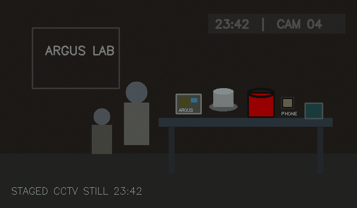

# The Last Chai

**An interactive OpenCV murder-mystery workshop** for AI CoLegion at VESIT. Participants join fictional surveillance system ARGUS to investigate a staged lab incident through image enhancement, scene comparison, HSV segmentation and video tracking.

> This is a fictional educational simulation. Every character, incident, image and system log is invented. Visual algorithms identify pixel patterns and motion; the case file supplies the story's identity and ownership claims.



## Workshop path

| Mission | Computer-vision practice | Evidence |
| --- | --- | --- |
| 1. Eyes Online | Image arrays, BGR/grayscale, brightness, histograms, equalization, CLAHE, crop/save | Staged clock overlay: 23:42 |
| 2. The Missing Clue | Pretrained YOLOv8n COCO ONNX inference when set up; explicit scene-comparison fallback when weights are absent | Live predictions on staged scenes or selected real photos; prepared inventory is separate |
| 3. The Red Bag | HSV dual-range red mask, morphology, contours | Color candidate; ownership remains a case-file fact |
| 4. Follow the Trail | VideoCapture, centers, trails and exit-line crossing | Observed red-candidate movement plus separate fictional system log |

The portal shows real outputs from the included Python modules and explains the OpenCV steps level by level. Each mission has prepared sample choices and live controls; changes are passed to Python/OpenCV and affect new outputs. Level 2 includes three CC0 real-photo samples as well as staged artwork. Level 2 accepts video for first-frame edge analysis or model inference when weights are present; Level 4 processes video frame by frame. Missions 1–3 support camera still capture; Level 4 camera stills run color-candidate analysis while a recorded clip is needed for tracking. Camera access requires browser permission; localhost is a secure context. Files are processed by the local Python server only, limited to 18 MB, and temporary uploaded sources are removed after processing. Generated annotated video results stay under ignored `outputs/`. Mission progress is stored in local browser storage; large inline pixel images are omitted on reload and can be regenerated by running the analysis again. The portal never represents the detector as available when weights are missing.

## Requirements and tested setup

Tested here on macOS arm64, Python 3.9.6, OpenCV 4.11.0, NumPy 1.26.4, pytest 8.4.2 and nbformat 5.10.4. Python 3.9+ is supported by the code; Python 3.11+ is recommended for a new workshop install. Node is not needed. The portal uses Python's standard-library HTTP server and static HTML/CSS/JavaScript.

### Setup

```sh
cd the-last-chai
python3 --version
python3 -m venv .venv
source .venv/bin/activate        # macOS/Linux
# .venv\Scripts\activate       # Windows PowerShell
python -m pip install --upgrade pip
python -m pip install -r requirements.txt
python -m pip install -e .
python -m pip install jupyterlab  # needed only to launch notebooks
python scripts/prepare_data.py
python scripts/verify_assets.py
```

For live YOLO inference, install the optional exporter and prepare local CPU-compatible weights. First setup downloads a 6.2 MB checkpoint, installs PyTorch, and exports an approximately 12 MB ONNX model:

```sh
python -m pip install -e ".[model]"
python scripts/setup_model.py
```

Use `python` rather than `python3` after activating the environment. On macOS, installation may take a few minutes. `opencv-python-headless` avoids GUI library problems; notebooks display with Matplotlib and do not require `cv2.imshow()` or GUI trackbars.

### Run the portal

```sh
python scripts/server.py
```

Open <http://127.0.0.1:8000/app/>. Pick another port with `python scripts/server.py 8001`. The service binds only to localhost. Allow the browser to open a new tab for the print report. Do not expose this training server to a public network.

### Run notebooks and tests

```sh
jupyter lab notebooks/
python -m pytest -q
python scripts/verify_assets.py
python scripts/run_demo.py
```

Run notebooks from the repository root. Each notebook imports `src/the_last_chai`, so the package install (`python -m pip install -e .`) or adding `src` to the import path is required.

## Level 2 model

YOLOv8n pretrained on COCO is used. `scripts/setup_model.py` downloads the official 6.2 MB checkpoint and exports a fixed 640x640 ONNX model to `models/yolov8n.onnx`; neither weight file is tracked by Git. The model supports COCO labels including person, backpack, cup, and cell phone, but synthetic drawings may not look like its training photographs. Three selected real photos exercise person/backpack, cell-phone/person, and cup-related predictions. In local evaluation, YOLO found a person in the backpack photo and a cell phone in the phone photo, but did not consistently label every object; the coffee scene produced false positives. This is a useful limitation, not a guarantee. Without the ONNX file the app clearly falls back to pixel comparison/edge analysis and makes no semantic detection claims. No custom model training was performed. Ultralytics model/software terms are AGPL-3.0; review [Asset Credits](docs/ASSET_CREDITS.md) before redistribution or deployment.

Organizers can optionally fine-tune a custom YOLOv8 detector before the event; the labeled dataset is not bundled. Follow the [custom training setup](docs/SETUP_GUIDE.md#fine-tune-a-custom-detector-organizers). The trainer requires separate scene-level train, validation and test splits, evaluates the held-out test set, and exports a custom ONNX model for the portal. No custom-trained model is claimed or included.

## Repository map

```text
app/                  Browser investigation interface
assets/images/        Synthetic evidence and three CC0 real-photo samples
assets/portraits/     Fictional, initials-based suspect artwork
assets/references/    Prepared enhancement reference images
assets/videos/        Three controlled synthetic tracking clips
backend/README.md     Backend/API operating notes
data/                  Dataset provenance, evidence registry, and fictional case log
 docs/                 Facilitator and participant materials
 notebooks/            Four executable Jupyter notebooks
 scripts/              Asset generation, audit, local server, demo
 src/the_last_chai/   Reusable OpenCV and evidence modules
tests/                 Deterministic automated tests
```

## Story and facilitation

- [Storyline](docs/STORYLINE.md)
- [Instructor guide and timing](docs/INSTRUCTOR_GUIDE.md)
- [Participant handbook](docs/PARTICIPANT_HANDBOOK.md)
- [Setup guide](docs/SETUP_GUIDE.md)
- [Troubleshooting](docs/TROUBLESHOOTING.md)
- [Asset credits](docs/ASSET_CREDITS.md)
- [Canonical solution](docs/FINAL_SOLUTION.md) (withhold until the finale)

## Limitations

- Fictional scenes, silhouettes, and corridor clips are original synthetic drawings. Three separate CC0 photographs are included for detector evaluation; they are not part of the fictional case and do not identify any suspect.
- The 23:42 timestamp is a staged overlay. Enhancement makes it more legible but does not establish a real time of death.
- Level 2 ONNX weights are generated locally with `scripts/setup_model.py` and ignored by Git. Without those weights, scene comparison and inventory are a distinct prepared fallback, not precomputed model inference.
- The red detector finds red regions and can produce false positives. The tracker follows the largest qualifying red region and can fail under occlusion or competing objects.
- The case's identity, ownership, and 23:44 log are separate fictional narrative assets.
- Print-to-PDF uses the browser's print dialog; no PDF library is required.
- This project was exercised on the local macOS environment described above. Windows and Linux instructions are provided but were not tested in this session.

## Contributing and publication

Keep generated output under `outputs/` (ignored by Git), retain fictional-evidence disclaimers, and add tests for algorithm changes. Asset originals are generated by `scripts/prepare_data.py`.

To prepare a local Git repository and publish it yourself:

```sh
git init
git add .
git commit -m "Build The Last Chai OpenCV workshop"
# Create an empty remote repository on your chosen Git hosting service, then:
git branch -M main
git remote add origin <your-remote-url>
git push -u origin main
```

No remote repository has been created or published by this project setup.
